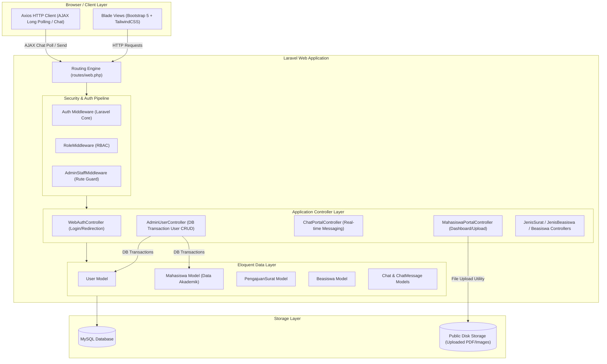

# Scholarship System - FIKOM UMI

Sistem Informasi Manajemen Pengajuan Beasiswa dan Surat Rekomendasi Fakultas Ilmu Komputer, Universitas Muslim Indonesia (FIKOM UMI). Aplikasi ini dirancang menggunakan arsitektur web modern yang aman, responsif, dan berbasis komponen.

---

## 📑 Analisis Pemenuhan Persyaratan Teknis

Berdasarkan lembar persyaratan teknis FIKOM UMI, berikut adalah tabel kesesuaian proyek kita:

| Persyaratan Teknis | Ketentuan Gambar | Implementasi Proyek Kita | Status |
| :--- | :--- | :--- | :---: |
| **a. Framework Utama** | Angular, React, Vue, Spring, ASP.NET Core, atau **Laravel** | **Laravel 12 (PHP)** dengan build tool **Vite** & template engine **Laravel Blade** | **MEMENUHI** |
| **b. Komponen/Library Tambahan** | Minimal menggunakan **5 komponen/library tambahan** untuk fungsionalitas spesifik | Menggunakan 7 library tambahan (Laravel Sanctum, Axios, TailwindCSS, Bootstrap Icons, FakerPHP, PHPUnit, Laravel Tinker) | **MEMENUHI** |
| **c. Arsitektur** | Berbasis komponen terpisah, *loose coupling*, *high cohesion*, spesifikasi *interface* | Menerapkan arsitektur **MVC (Model-View-Controller)** yang terpisah jelas, pembagian *domain layers*, middleware pipeline, dan RESTful/Web interfaces | **MEMENUHI** |

---

## 🏗️ Gambaran Umum Arsitektur (Architecture Overview)

Aplikasi ini menggunakan pola arsitektur **MVC (Model-View-Controller)** yang dikombinasikan dengan pipeline **Middleware** untuk otorisasi akses (*Role-Based Access Control*). Pemisahan tanggung jawab (*Separation of Concerns*) diterapkan secara ketat demi mewujudkan prinsip *loose coupling* dan *high cohesion*.

### Component Diagram (Mermaid)



---

## 📦 Daftar Komponen / Library Tambahan (Minimal 5)

Berikut adalah 7 library tambahan yang digunakan dalam aplikasi ini untuk menunjang fungsionalitas spesifik:

1. **Laravel Sanctum (Authentication Library):** Menyediakan sistem otentikasi token yang aman untuk API serta proteksi session berbasis cookie state.
2. **Axios (AJAX/HTTP Client Library):** Digunakan pada frontend untuk melakukan request pengiriman pesan dan sinkronisasi pesan baru secara *asynchronous* (long polling) pada modul live chat tanpa memuat ulang halaman (reload).
3. **TailwindCSS (Styling & CSS Utility Library):** Digunakan untuk merancang antarmuka Landing Page yang dinamis, modern, dan bernuansa premium hitam-emas.
4. **Bootstrap Icons (Icon Library):** Library ikon vektor yang digunakan secara luas pada menu sidebar, tabel data master, dan tombol aksi di dashboard admin & mahasiswa.
5. **FakerPHP (Data Generation Library):** Digunakan untuk mengisi basis data uji secara otomatis (*seeding*) dengan data nama, email, NIM, IPK, dan program studi tiruan yang valid.
6. **PHPUnit (Testing Library):** Framework pengujian bawaan untuk memastikan stabilitas kode melalui unit testing dan feature testing secara otomatis.
7. **Laravel Tinker (Database/REPL Utility):** Utilitas baris perintah interaktif untuk melakukan debugging query Eloquent ORM dan manipulasi database langsung dari terminal.

---

## 🧩 Struktur dan Hierarki Komponen

Aplikasi dibagi menjadi komponen-komponen mandiri yang dikelompokkan berdasarkan fungsinya (*high cohesion*):

```
app/
├── Http/
│   ├── Controllers/         # Controller Layer (Loose Coupling Logic)
│   │   ├── AdminUserController.php
│   │   ├── ChatPortalController.php
│   │   ├── MahasiswaPortalController.php
│   │   └── WebAuthController.php
│   └── Middleware/          # Security Gate & Pipeline Components
│       ├── AdminStaffMiddleware.php
│       └── RoleMiddleware.php
└── Models/                  # Data Layer (Eloquent Domain Components)
    ├── User.php
    ├── Mahasiswa.php
    ├── Beasiswa.php
    └── ChatMessage.php

resources/
└── views/                   # Presentation Layer (Blade Components)
    ├── layouts/
    │   └── admin.blade.php  # Main Dashboard Base Layout
    ├── admin/               # Admin Master Data Views
    │   ├── users/
    │   ├── beasiswa/
    │   ├── jenis_surat/
    │   └── jenis_beasiswa/
    ├── chat/                # Live Chat Component View
    └── mahasiswa/           # Student Portal Views
```

---

## 🔌 Spesifikasi Antarmuka Komponen (Interface Specifications)

Komponen-komponen berinteraksi melalui interface yang terdefinisi dengan jelas di rute aplikasi:

### 1. Web/Routing Interface (routes/web.php)
*   **Authentication Portal:**
    *   `POST /login` $\rightarrow$ Diproses oleh `WebAuthController@login`.
*   **Student Portal Interface:**
    *   `GET /mahasiswa/dashboard` $\rightarrow$ Menampilkan statistik mahasiswa.
    *   `POST /mahasiswa/surat` $\rightarrow$ Submit pengajuan surat + upload berkas.
*   **Live Chat API & long polling:**
    *   `POST /chat/start` $\rightarrow$ Membuat sesi chat baru.
    *   `POST /chat/{id}/send` $\rightarrow$ Mengirim pesan chat (mengembalikan JSON `{success: true, message: {...}}`).
    *   `GET /chat/{id}/messages` $\rightarrow$ Mengembalikan data pesan baru dalam format JSON untuk sinkronisasi chat.
*   **Admin CRUD Master Data:**
    *   `POST /admin/users` $\rightarrow$ Simpan user baru (Admin/Staff/WD3/Mahasiswa).
    *   `PUT /admin/users/{id}` $\rightarrow$ Perbarui profil user & data akademik mahasiswa.

---

## 🤝 Pola Integrasi (Integration Patterns)

1. **Model-View-Controller (MVC):** Controller memproses input dari View, berinteraksi dengan Model, dan mengirimkan kembali respons data atau view ter-render.
2. **Middleware Pipeline Pattern:** Setiap HTTP request disaring melewati antrean middleware (`auth`, `role`, `admin_staff`) secara berurutan sebelum mencapai controller bisnis.
3. **Database Transaction Pattern (Unit of Work):** Pada penyimpanan data pengguna, jika role yang dipilih adalah mahasiswa, sistem membungkus query penyimpanan `User` dan `Mahasiswa` ke dalam `DB::transaction()`. Jika salah satu gagal, seluruh operasi dibatalkan (*rollback*) untuk menjaga integritas data.
4. **Asynchronous Polling Pattern:** Integrasi AJAX antara Axios pada client Blade View dan endpoint JSON di Controller untuk pembaruan pesan obrolan secara dinamis setiap 3 detik.

---

## 🛠️ Manajemen Dependensi (Dependency Management)

Dependensi dikelola secara terisolasi menggunakan dua package manager standar industri:
*   **Composer (PHP/Backend):** Mengelola library backend seperti Laravel framework, Laravel Sanctum, Tinker, dan PHPUnit (didefinisikan di `composer.json`).
*   **NPM (Javascript/CSS/Frontend):** Mengelola modul frontend seperti TailwindCSS, Vite, Axios, dan Concurrently (didefinisikan di `package.json`).

---

## 🚀 Strategi Penerapan (Deployment Strategy)

Aplikasi dirancang agar mudah dideploy menggunakan arsitektur stack standar (LAMP/LEMP Stack):
1. **Prasyarat Server:** PHP >= 8.2, webserver (Apache/Nginx), basis data MySQL/MariaDB.
2. **Langkah Instalasi (Command Script):**
   *   Jalankan script setup otomatis: `composer run setup` (atau secara manual: `composer install`, `npm install`, `php artisan migrate`, dan `npm run build`).
3. **Penyimpanan Berkas (Uploads):** Jalankan `php artisan storage:link` untuk membuat shortcut simbolik dari direktori penyimpanan internal privat ke folder publik agar berkas unggahan surat rekomendasi mahasiswa dapat diakses secara publik dengan aman.
